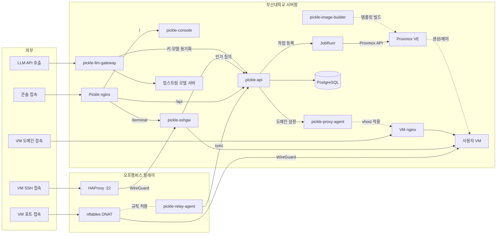

# pickle-secrets-example

호스트 시크릿 볼트의 구조와 운용 절차를 보여 주는 공개 예시예요.
실제 볼트는 비공개이며 이 레포지토리에는 자리표시자만 있어요.
키와 비밀번호, 토큰, 도메인과 호스트명 모두 실제 값이 아니에요.

<a id="풀려는-문제"></a>
<a id="주요-기능"></a>

## 보관과 복구

각 컨테이너가 읽는 env와 Proxmox API 토큰, SSH 개인키, 인증서 키의 원본을 한 곳에서
관리하는 구조예요. 실제 볼트는 지정한 시크릿을 git-crypt 암호문으로 커밋하고
복호화 키는 레포지토리 밖에 별도 보관해요. 잠금 해제한 워킹트리에는 평문이 남아요.

클론과 잠금 해제, 퍼미션 재적용으로 자격증명 원본을 복구해요. 값의 변경은 커밋 이력으로
추적하며 DB 데이터나 컨테이너 디스크는 별도 백업으로 복원해야 해요.

## 구성

```
.gitattributes              어떤 경로를 암호화할지 정하는 단일 지점
.gitignore                  복호화 키 파일을 실수로 커밋하지 않도록 차단
api.env                     pickle-api 마스터 env          → 암호화
llm-gateway.env             LLM 게이트웨이 런타임 env      → 암호화
discord-ops-webhook.key     운영 알림 채널의 webhook URL   → 암호화
proxmox-token.json          Proxmox API 토큰                → 암호화
lightsail-ssh.pem           릴레이 SSH 개인키               → 암호화
sshgw-ssh_host_ed25519_key  게이트웨이 호스트키 백업        → 암호화
sshgw-upstream_ed25519_key  게이트웨이 → VM 홉 개인키       → 암호화
sshgw-terminal_ed25519_key  웹 터미널 브리지 개인키         → 암호화
monitoring-public-canary.key  공개 LLM 진단 키 복구 사본     → 암호화
origin-ca/<존>.key          존별 Origin CA 개인키           → 암호화
origin-ca/<존>.crt          대응 인증서                        평문 (공개물)
sshgw-*_ed25519_key.pub     대응 공개키                        평문 (공개물)
```

Origin CA의 키와 인증서는 존마다 별도 파일로 둬요. 다른 존의 파일로 덮어쓰면 기존
SAN의 이름이 인증서를 잃어요.

`.gitattributes`에는 `*.key`, `*_key`, `*.pem` 모양 규칙을 먼저 둬요.
**암호화 규칙에 맞지 않는 경로의 파일은 경고 없이 평문으로 커밋될 수 있어요.**
새 자격증명을 넣기 전에 해당 경로의 규칙을 확인해요.

`api.env`, `llm-gateway.env`, `proxmox-token.json`, `discord-ops-webhook.key`,
`monitoring-public-canary.key`는 `.example` 접미사를 붙인 자리표시자로 제공해요.
나머지 키 파일은 실제 값이 없어 예시 파일을 제공하지 않아요.

운영 알림 webhook은 실제 발송 주소를 각 호스트의 root 전용
`/etc/pickle-discord-alerts/webhook`에 `0600`으로 배치해요. URL은 비밀이며 일반 로그나
평문 Git 기록에 넣지 않아요.

진단 키는 운영자 소유 workspace에 발급해 허용 endpoint와 요청량, 동시 실행,
일일 토큰, 유료 크레딧, 만료를 제한해요. 진단 서버의 root 전용 파일에 배포하며 값은 출력하지 않아요.

<a id="셋업"></a>

## git-crypt 설정

다음은 실제 볼트를 새로 준비할 때 쓰는 예시예요. 이 공개 예시 레포지토리는 git-crypt를
설정하지 않아요.

```bash
git init
git-crypt init
# .gitattributes 작성 후
git-crypt export-key /path/to/vault.key   # 이 파일을 오프라인 매체에 보관
```

`export-key`로 내보낸 키는 레포지토리 밖에 보관해요. `.git/git-crypt/keys/default`의
사본은 클론이 사라지면 함께 사라져요. 복호화 키 사본을 모두 잃으면 암호문을 복호화할 수 없어요.

<a id="커밋이-암호문인지-확인하는-법"></a>

## 암호문 커밋 확인

암호화 블롭은 `\0GITCRYPT\0` 매직 헤더로 시작해요. 실제 볼트에서 push 전에 확인해요.

```bash
git cat-file blob HEAD:api.env | head -c 10 | od -An -c
#  \0   G   I   T   C   R   Y   P   T  \0     ← 암호문
```

주석이 기대하는 출력이에요. 다른 바이트가 나오면 평문으로 커밋됐을 수 있으므로 push를
멈추고 `.gitattributes`부터 확인해요.

<a id="복구"></a>

## 후보 core 복구

실제 볼트의 `candidate-core.key`는 기존 `*.key` 규칙으로 암호화한 tar bundle이에요.
기존 서비스와 분리된 API env, DB password, DB CA와 server 인증서/키, 최초 검증 관리자 입력,
core 설정과 소유권 manifest를 담아요. 각 member는 0600이며 `SHA256SUMS`로 추출 결과를 대조해요.
이 공개 예시는 파일 이름과 절차만 설명하고 실제 bundle과 키는 제공하지 않아요.

잠금 해제한 볼트에서 새 root 전용 디렉터리로만 추출해요. 디렉터리가 이미 있으면 중단하고
기존 서비스 파일을 덮어쓰지 않아요.

```bash
(
set -eu
umask 077
mkdir -m 700 /root/candidate-core-recovery
tar -xf candidate-core.key -C /root/candidate-core-recovery
cd /root/candidate-core-recovery
sha256sum -c SHA256SUMS
)
```

bundle은 자격증명과 설정의 복구 사본이에요. DB 데이터와 컨테이너 디스크는 별도 백업으로
복원하고 CA private key는 DB와 앱 LXC에 배포하지 않아요. Git 복호화 키도 bundle과 별도로 보관해요.

```bash
umask 077
git clone <remote> vault && cd vault
git-crypt unlock /path/to/vault.key
chmod 600 monitoring-public-canary.key candidate-core.key candidate-db-backup.key api.env llm-gateway.env proxmox-token.json lightsail-ssh.pem \
          sshgw-*_ed25519_key origin-ca/*.key
```

Git은 실행 비트 외의 퍼미션을 보존하지 않아요. 클론 환경에 따라 파일이 0644일 수 있어
복구 절차에서 자격증명 파일의 권한을 다시 적용해요.

### 후보 control link bundle

`candidate-control-links.key`는 후보 API와 core 서비스의 연결 설정 복구 사본이에요.
API와 core의 env, 서비스 설정, Proxmox API 토큰, proxy와 SSH gateway 연결 토큰,
SSH gateway의 개인키와 공개키, 설정 파일 manifest, 원본 commit과 `SHA256SUMS`를 담아요.
DB 데이터는 없으며 실제 값과 bundle은 비공개 볼트에만 둬요.

새 root 전용 디렉터리에 추출하고 모든 일반 파일을 0600으로 맞춰요.
`SHA256SUMS`와 manifest의 파일 목록, 원본 commit을 확인해요. 다음 명령은 추출 결과만
검사하며 서비스 경로에는 설치하지 않아요.

```bash
(
set -eu
umask 077
bundle=/protected/candidate-control-links.key
recovery_dir=/root/candidate-control-links-recovery
test ! -e "$recovery_dir"
mkdir -m 700 "$recovery_dir"
tar -xf "$bundle" -C "$recovery_dir"
find "$recovery_dir" -type d -exec chmod 700 {} +
find "$recovery_dir" -type f -exec chmod 600 {} +
cd "$recovery_dir"
sha256sum -c SHA256SUMS
)
```

대상 경로와 소유자, 생성 입력은 manifest의 `install_map`과 `input_only`에서 확인해요.
API와 core의 env, Proxmox 토큰, proxy와 SSH gateway 토큰, SSH gateway 키와 서비스 설정을
한 구성으로 대조한 뒤 각 대상에 설치해요. pve1의 기존 서비스 파일이나 실행 중인 구성은
덮어쓰지 않아요.

이전 환경의 후보 DB source writer 상태를 먼저 확인해요. 실행 중이면 중지하거나 격리하고,
단일 writer임을 확인한 뒤 복구한 설정으로 API를 기동하고 잡을 활성화해요. 복원한 키와 토큰은 정상적인
자격증명 회전 절차로 바꾸고 연결을 확인한 뒤 이전 값을 폐기해요.
평문 bundle이나 추출본은 공개 레포지토리에 복사하지 않아요.

### 후보 DB 백업 자격증명 bundle

`candidate-core.key`와 별도로 DB 백업의 암호화 bundle을 보관해요. Client encryption key,
source writer와 독립 monitor reader의 PBS API token payload, 두 실행 환경의 설정,
복구 사본 검증 기록과 custody manifest, `SHA256SUMS`가 들어 있어요.
실제 값과 bundle은 이 공개 예시에 넣지 않아요.

API token은 회전하거나 폐기할 수 있어도 기존 암호화 archive를 읽는 데에는 당시의
client encryption key가 계속 필요해요. 새 root 전용 디렉터리에 모든 member를 0600으로
추출하고 해시를 확인해요. 기존 디렉터리나 서비스 파일을 덮어쓰거나 writer instance 두 개를
자동 기동하지 않아요.

```bash
(
set -eu
umask 077
bundle=/protected/candidate-db-backup.key
recovery_dir=/root/candidate-db-backup-recovery
test ! -e "$recovery_dir"
mkdir -m 700 "$recovery_dir"
tar -xf "$bundle" -C "$recovery_dir"
find "$recovery_dir" -type f -exec chmod 600 {} +
cd "$recovery_dir"
sha256sum -c SHA256SUMS
)
```

검증 뒤에도 token payload와 encryption key의 소유자와 퍼미션을 확인하고 필요한 writer
또는 monitor 하나만 별도 절차로 기동해요. 이 복구만으로 DB 데이터가 복원되거나 서비스가 기동되지는 않아요.

### 후보 서비스 백업 복구 자료

실제 볼트는 DB 백업과 분리된 서비스 백업 복구 bundle도 암호화해 보관해요.
Client encryption key와 별도 writer token, reader token, 소유자와 권한 manifest, 복구 절차,
`SHA256SUMS`가 들어 있어요. 이 공개 예시에는 bundle이나 실제 값을 싣지 않아요.

tar를 풀기 전에 예상한 일반 파일뿐인지 확인해요. 절대 경로와 상위 경로, 링크가 있으면 중단해요.
새 root 전용 디렉터리에 추출하고 내부 checksum을 확인해요. 별도 보관한 원본 key SHA-256과
독립 복원 노드의 key 사본도 대조해요.

원본 writer와 백업 job 실행 주체가 정지하거나 격리됐는지 확인한 뒤 reader로 실제 백업을 읽어요.
Token을 바꾸더라도 기존 archive를 읽어야 하면 당시 client key를 보존해요.

<a id="운용에서-지키는-것"></a>

## 운용 중 확인

- `git-crypt lock` 상태로 방치하면 평문을 기대하는 배포 스크립트가 잘못된 파일을 배포할 수 있어요.
- 볼트와 라이브의 키 이름별 해시를 주기적으로 비교해 값이 같은지 확인해요. 값 자체는 출력하지 않아요.
- 회전은 볼트와 라이브를 같은 작업 단위에서 갱신해요. Proxmox 토큰처럼 같은 값이 여러 파일에 있으면 함께 바꿔요.
- 회전 중 만든 임시 평문 백업은 대조를 마치면 파기해요.

<a id="실제-볼트와-다른-점"></a>

## 실제 볼트와 차이

| 항목 | 실제 볼트 | 이 예시본 |
|---|---|---|
| 자격증명 값 | git-crypt 암호문 커밋 | 자리표시자만 제공 |
| 파일 이름 | `api.env`, `llm-gateway.env`, `proxmox-token.json` | `.example` 접미사 사용 |
| 키 파일 | 암호화 커밋 | 진단 키는 자리표시자만 제공 |
| 도메인과 호스트 | 실제 값 | `example.ac.kr` 등 예시 도메인 |
| git-crypt | 설정됨 | 설정하지 않음 |

최종 갱신: 2026-11-03

## 전체 아키텍처

<!-- arch:begin -->


| 레포지토리 | 역할 |
|---|---|
| [pickle-api](https://github.com/PNUops/pickle-api) | REST API와 프로비저닝 워커 (Spring Boot 4, Java 25, PostgreSQL 18, JobRunr) |
| [pickle-console](https://github.com/PNUops/pickle-console) | 사용자·관리자 웹 콘솔 (React 19, TypeScript) |
| [pickle-sshgw](https://github.com/PNUops/pickle-sshgw) | SSH 게이트웨이와 웹 터미널 브리지 (sshpiperd, Go) |
| [pickle-proxy-agent](https://github.com/PNUops/pickle-proxy-agent) | nginx 리버스 프록시 제어 에이전트 (Go) |
| [pickle-relay-agent](https://github.com/PNUops/pickle-relay-agent) | 오프캠퍼스 릴레이의 nftables DNAT 에이전트 (Go) |
| [pickle-llm-gateway](https://github.com/PNUops/pickle-llm-gateway) | 교내 LLM API 게이트웨이 (Go) |
| [pickle-image-builder](https://github.com/PNUops/pickle-image-builder) | 사용자 VM OS 이미지 빌드 레시피 (shell, virt-customize) |
| [pickle-infra](https://github.com/PNUops/pickle-infra) (비공개) | 인프라 프로비저닝 스크립트와 운영 런북 (shell) |
| [pickle-infra-example](https://github.com/PNUops/pickle-infra-example) | 프로비저닝·배포 스크립트와 런북 샘플 |
| [pickle-secrets](https://github.com/PNUops/pickle-secrets) (비공개) | 호스트 시크릿 볼트 (git-crypt) |
| [pickle-secrets-example](https://github.com/PNUops/pickle-secrets-example) | 볼트 레이아웃과 git-crypt 운용 절차 |
<!-- arch:end -->
